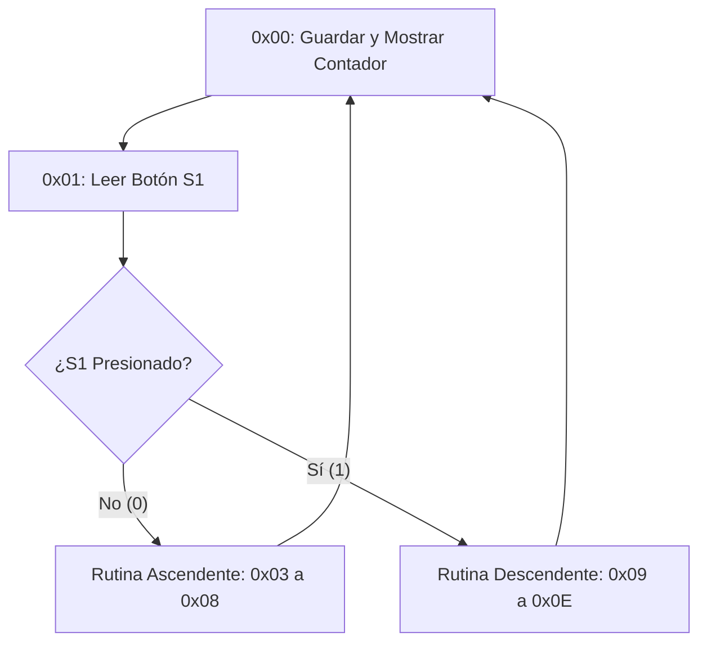

# Funcionamiento de la Memoria de Programa (`Program_memory.v`) y el Formato de Instrucciones

Este documento explica de forma detallada y paso a paso cómo está estructurado el núcleo de procesamiento de nuestro PLC y cómo se programan las instrucciones de 40 bits en la ROM para controlar lógica secuencial (como un contador ascendente/descendente con botones).

---

## 1. Anatomía de una Instrucción de 40 Bits

A diferencia de los procesadores tradicionales de 8 o 32 bits, este PLC utiliza una **arquitectura de palabra larga de 40 bits** por instrucción. Esto permite empaquetar en un solo ciclo de reloj la acción que se desea realizar y el dato o dirección con el que interactúa.

Cada instrucción de 40 bits se divide visualmente en los siguientes campos:

```text
[ Bits 39:38 ]  [ Bits 37:32 ]  [ Bits 31:0 ]
-------------------------------------------------
  Modo/Destino     Opcode          Operando / Dirección / Valor literal
```

* **Bits [39:38] (Modo / Selección de Puerto):** Indican si la operación se aplica sobre la memoria de palabras (`M1_x`), sobre bits, o si es un comando de control puro.
* **Bits [37:32] (Opcode / Código de Operación):** Es el código binario de 6 bits que define **qué acción** va a ejecutar la Unidad de Control y la ALU (por ejemplo: sumar, comparar, saltar, leer una entrada física).
* **Bits [31:0] (Operando / Dirección):** Contiene el dato inmediato, el número de comparación o la dirección de memoria/salto hacia donde debe dirigirse el flujo del programa.

---

## 2. Descripción de las Instrucciones Clave Utilizadas

Para el funcionamiento de nuestro contador sincronizado con los botones físicos de la FPGA, utilizamos las siguientes instrucciones esenciales:

1. **`ST_W %MW0` (Store Word):**
   * *Función:* Toma el valor actual que se encuentra en el acumulador del procesador y lo guarda en la dirección de memoria interna `%MW0`. 
   * *Propósito en el sistema:* Actualiza la variable del contador y refresca de inmediato el puerto de salida físico (`oQ0_X`) para que los LEDs o el display muestren el número correcto.

2. **`LD %I0.0` (Load Bit):**
   * *Función:* Lee el estado lógico de la entrada digital `%I0.0` (en nuestro hardware físico, corresponde al botón **S1**).
   * *Propósito en el sistema:* Carga un `0` (botón sin presionar) o un `1` (botón presionado) en el acumulador de bits para que el procesador tome decisiones.

3. **`JMP_C` (Jump Conditional / Salto Condicional):**
   * *Función:* Evalúa el estado del acumulador de bits. Si la condición previa es verdadera (`1`), desvía el flujo del programa hacia la dirección especificada en los bits más bajos; de lo contrario, el programa continúa su curso normal línea por línea.
   * *Propósito en el sistema:* Permite alternar entre el modo de conteo ascendente y descendente según el usuario presione el botón S1.

4. **Comparaciones y Aritmética (`EQ_W`, `ADD_I`, `SUB_I`):**
   * **`EQ_W 9` / `EQ_W 0`:** Compara si el contador llegó al límite superior (9) o inferior (0).
   * **`ADD_I 1` / `SUB_I 1`:** Incrementa o decrementa en una unidad el valor del acumulador.

---

## 3. Flujo Paso a Paso del Programa Actual (`Program_memory.v`)

El programa implementado en la ROM opera como un ciclo cerrado infinito dividido en dos grandes rutas:



### Paso a paso detallado:
* **Dirección `0x00` (`ST_W`):** Se guarda el estado actual del número en memoria y se refleja en las salidas de la tarjeta.
* **Direcciones `0x01` y `0x02` (`LD` + `JMP_C`):** Se lee el botón `S1`. Si está activo, el programa salta directo a la línea `0x09` (modo resta). Si está inactivo, avanza a la línea `0x03` (modo suma).
* **Camino Ascendente (`0x03 - 0x08`):**
  * Revisa si el número es igual al límite `9`. Si es así, salta a reiniciar la cuenta a `0`.
  * Si no es `9`, le suma `1` (`ADD_I 1`) y regresa al inicio (`0x00`).
* **Camino Descendente (`0x09 - 0x0E`):**
  * Revisa si el número es igual a `0`. Si es así, salta a recargar el `9`.
  * Si no es `0`, le resta `1` (`SUB_I 1`) y regresa al inicio (`0x00`).